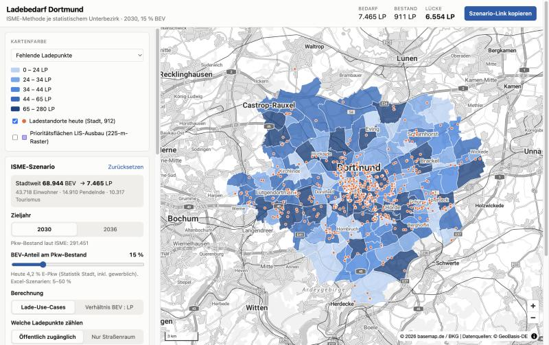
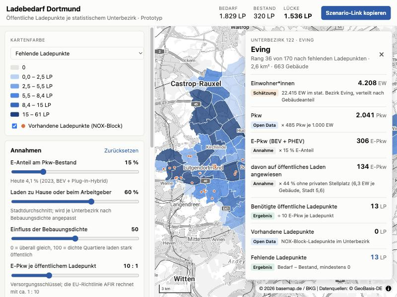

# Ladebedarf Dortmund - Need for Speed Charge (Dortmund Edition)

Prototype for the City of Dortmund challenge **"Bedarfsgerechte Ladeinfrastruktur für Dortmund"** (demand-oriented charging infrastructure). It applies the city's own **ISME calculation method** to the city's data for Dortmund's 145 statistical *Unterbezirke*: how many publicly accessible EV charging points each one needs, how many exist, and every factor behind the number.



- [Team resources](#team-resources)
- [The challenge](#the-challenge)
- [Our solution](#our-solution)
- [Calculation method](#calculation-method)
- [Data sources](#data-sources)
- [Known data gaps](#known-data-gaps)
- [Getting started](#getting-started)
- [Deploy to Vercel](#deploy-to-vercel)
- [Project structure](#project-structure)
- [Roadmap and open tasks](#roadmap-and-open-tasks)

---

## Team resources

Challenge material shared via Sciebo (TU Dortmund):

| Folder | Contents |
|---|---|
| [Daten für Verwaltungschallenge (Team 07)](https://tu-dortmund.sciebo.de/s/kHXddKmMZpK8ECR?dir=/Teams/07_Team/Daten%20f%C3%BCr%20Verwaltungschallenge) | Data provided for the City of Dortmund challenge |
| [Challenges](https://tu-dortmund.sciebo.de/s/kHXddKmMZpK8ECR?dir=/Challenges&editing=false&openfile=true) | Challenge briefs, including this one (*Stadtverwaltung Challenge 1*) |

In the repo:

- [Challenge brief (PDF)](docs/challenge/Stadtverwaltung_Challenge_1.pdf), *Stadtverwaltung Challenge 1*, from the Sciebo *Challenges* folder
- [Team brief](docs/team-brief.md): problem, method, data and open tasks on one page
- [Brainstorming strategy](docs/brainstorming.md): 90-minute kickoff for Philipp, Mehul and Klevis, the city's ISME method, mentor questions and the plan until the pitch

The Sciebo data folder holds the city's **ISME calculation method** (Excel + report), **car and EV stock per Unterbezirk** (145 units), **912 current charging locations**, a 225 m priority grid and commercial areas. The app is built on this data: `npm run data` downloads it, and the processed GeoJSON in `public/data/city/` is committed so the app builds without network access. The raw files (shapefiles, Excel, report) are not committed.

---

## The challenge

| | |
|---|---|
| **Title** | Bedarfsgerechte Ladeinfrastruktur für Dortmund / Demand-Oriented Charging Infrastructure for Dortmund |
| **Enterprise** | Stadt Dortmund (City of Dortmund) |
| **Summary** | Build a digital tool that calculates and clearly visualises the spatial demand for publicly accessible EV charging infrastructure in Dortmund, at the level of statistical subdistricts, and transparently prioritises potential locations. |

**Problem.** Electric mobility needs a city-wide, demand-oriented network of public charging points. At the same time charging points compete for scarce street space with cycle paths, wider pavements, greenery and public spaces. So Dortmund wants to expand only where there is a transparent, demonstrable need.

**Task.** Build an interface that lets users calculate, compare and visualise charging demand quickly, per statistical subdistrict, with the relevant factors visible. Combine the city's calculation method with datasets such as vehicle ownership, population, building structure, private parking availability, existing charging infrastructure, land use and mobility. The result can be a map, dashboard, calculation tool or web app.

**Hard part.** Statistical, building, land-use and mobility datasets must be merged into one transparent, spatially differentiated demand calculation.

**Target group.** City administration staff, municipal planning and transport stakeholders, energy providers and other organisations supporting the expansion of public charging.

**Non-goals.** No implementation-ready site plan, no grid-connection assessment, no market-ready product. The focus is a transparent calculation, an understandable map and a prototype that supports municipal planning.

**Judging focus.** Quick analysis per statistical subdistrict, transparent criteria, clear value for municipal planning.

**Provided by the city.** Introduction and expert support; a basic demand-calculation method; selected datasets on statistics, building structure, land use, charging infrastructure and mobility.

---

## Our solution

A static web app (no backend) that runs the city's ISME method in the browser for all 145 Unterbezirke and updates instantly when a scenario changes.



**Working now**

- **Demand map.** The 145 Unterbezirke shaded by missing charging points, missing points per 1,000 cars, needed points, existing points, coverage, or today's EV share. Hover shows the value.
- **District detail.** Click a district for the full ISME chain: cars today → BEV of residents, commuters and tourists → charging points per use case → needed − existing = gap. Each step is tagged *Daten Stadt*, *ISME*, *Annahme* (assumption) or *Ergebnis* (result), with its formula.
- **ISME scenario controls.** Target year (2030 / 2036), BEV share (5–50 %), use-case or ratio method, street-space-only or all publicly accessible points, and the open questions in the Excel as switches.
- **Priority ranking.** Sortable table of all 145 districts with CSV export.
- **Map layers.** 912 current charging locations, the city's 225 m priority grid, and 3,446 public parking areas (OSM, multi-storey car parks, P+R) coloured by distance to the nearest charger: green ≤ 100 m, amber ≤ 225 m, red further.
- **More factors per district.** Public parking and how much of it has no charger nearby; buildings within 225 m of a charger (ISME walking distance for housing); car density; shopping and leisure destinations; commercial land; development plans since 2015.
- **Reports page** (`/berichte`): before/after, priorities, parking, walking-distance coverage, method and criteria, data quality. Printable, for building the presentation.
- **Shareable scenarios.** All settings and the selected district live in the URL. The "Szenario-Link kopieren" button copies it.

**Why it fits the judging criteria**

| Criterion | How we cover it |
|---|---|
| Quick analysis per subdistrict | One click on the map or table; recalculation is instant. |
| Transparent criteria | Every number shows its formula and whether it is city data, the ISME method, an assumption or a result. |
| Value for planning | The city's own method, per Unterbezirk; ranking and CSV export for council papers; scenario links for meetings. |

---

## Calculation method

The city's **ISME method** (*Berechnungsmethode ISME.xlsx* and *Gutachten ISME*, Dec 2023), implemented in [`src/lib/isme.ts`](src/lib/isme.ts). The tests in [`src/lib/isme.test.ts`](src/lib/isme.test.ts) reproduce the Excel cells.

**City level, as in the Excel:**

```
BEV residents   = cars(year) × BEV share            cars: 291,451 (2030) / 302,435 (2036)
BEV commuters   = 99,400 × BEV share                142,000 in-commuters × 70 % by car
BEV tourists    = (24,180,000 + 923,800) × BEV share / 365      day + overnight, 62 % by car

charging points = Σ over use cases  BEV × share ÷ BEV per point      (use-case method)
               or BEV ÷ 11 | 15 | 20                                  (ratio method)
```

| Use case | Share of BEV | BEV per point | Counts as |
|---|---:|---:|---|
| Detached house with parking | 8 % | 1.39 | private |
| Apartment building with parking | 44 % | 1.39 | private |
| Employer | 11 % | 1.17 | private |
| Public car parks | 2.6 % | 2.94 | publicly accessible |
| Customer parking incl. destinations | 10.3 % | 4.08 | publicly accessible |
| HPC hubs | 3.9 % | 19.1 | publicly accessible |
| Street space | 20.2 % | 2.8 (alt. 5) | publicly accessible, the city's direct lever |

**Per Unterbezirk (our addition, following chapter 6.1 of the report):**

```
BEV_u      = BEV residents × privateCars_u / Σ privateCars        (or by today's private EVs)
           + (BEV commuters + BEV tourists) × commercialCars_u / Σ commercialCars
needed_u   = charging points for BEV_u (method and scope as above)
existing_u = charging locations in u × points per location
gap_u      = max(0, needed_u − existing_u)
```

As in the report, commuters are spread by workplaces and tourists by points of interest: we use commercial/industrial land from the city's RVR land-use file for workplaces, and OpenStreetMap shops plus gastronomy, culture, sport and accommodation for destinations. Commercial cars remain switchable as a fallback. Per-district results always add up to the city total.

**Defaults:** 2030, 15 % BEV, use-case method, all publicly accessible points, 2.8 BEV per street point, 10.3 % customer parking, 1 charging point per location. At these settings the city needs 7,465 points; 912 locations exist.

### Bottom-up model (default)

[`src/lib/bottomup.ts`](src/lib/bottomup.ts) keeps the ISME structure but replaces each city-wide average that really differs between neighbourhoods with that Unterbezirk's own data. The city-wide ISME spread stays one click away ("Modell: ISME stadtweit") for comparison; the report *Von stadtweit zu Bottom-up* shows both side by side.

| ISME assumption | Bottom-up per Unterbezirk | Data |
|---|---|---|
| 52 % of BEV charge at home everywhere | Home share from the mix of dwellings in detached houses (≤ 2 storeys) vs apartment blocks: 20 % to 86 % | ALKIS buildings (function, storeys), Open Data |
| 2.8 BEV per street charging point everywhere | 1.5 in purely residential to 5 in commercial districts (overnight vs short stays) | ALKIS: shops, offices, industry vs housing |
| HPC can cut AC demand by up to 38 % (not located) | Existing HPC points (≥ 100 kW) absorb 19.1 BEV each from street demand in their district, max. 38 % | OpenStreetMap charging stations |
| Private cars only | Commercial cars × BEV share, 30 % of them charge publicly | City statistics per Unterbezirk |
| −20 % cars shown as a city-wide scenario | Reduction scaled by rail access: full in the best-served district, ~0 at the edge (off by default) | Open Data Stadtbahn stops + OSM rail/bus stops |
| Visitors split like residents (Excel) | Tourists charge only in public, commuters ~88 % at the employer | ISME report, Sankey (chapter 5.6) |
| Tourists spread by OSM shops/leisure only | Day tourists 50 % by the city's 99 attractions (sights, museums, venues, stadium) + 50 % by shops/leisure; overnight guests by 77 hotels/guest houses, with 1.58 M overnight stays (2024) | Open Data `sehenswurdigkeiten`, `museum`, `veranstaltungsorte`, Fremdenverkehr; OSM hotels |

With calibration on (default), home shares and sharing factors are scaled so the city averages stay 52 % and 2.8: local data redistributes the demand rather than inventing a new total. At 2030 / 15 % BEV the bottom-up model needs 8,552 public points (ISME spread: 7,465) and moves about 1,460 points between districts; street points at 18 % BEV come to ~6,600 (ISME report: 5,567, Excel: 5,969). Datasets suggested elsewhere, such as branches by sector, employees at place of work, households or social indicators, exist only city-wide or per Stadtbezirk, so they cannot differentiate Unterbezirke.

Data: [`scripts/build-bottomup.mjs`](scripts/build-bottomup.mjs) (part of `npm run data`). Tests: [`src/lib/bottomup.test.ts`](src/lib/bottomup.test.ts).

### Street-space factor model (data ready, not in the UI yet)

[`docs/factor-model.md`](docs/factor-model.md) computes street-space points per Unterbezirk for residents, commuters and tourists from Zensus 2022 dwellings, ALKIS garages and workplaces, OSM parking and visitor numbers. Each factor's formula, parameters, defaults and sources are documented there and in [`public/data/model/parameters.json`](public/data/model/parameters.json). The model was validated against real per-district data, and the doc includes a plausibility check of the ISME report. Inputs and reference results: `public/data/model/*.csv` (built by `scripts/model/build_factors.py`); implementation: [`src/lib/factors.ts`](src/lib/factors.ts).

**Open points in the city's material** (switchable in the app):

- The Excel labels customer parking 10.3 % but its formula uses 1.3 % (`=C22*0.013`).
- The charger file has 912 *locations*; whether these are stations or charging points is unclear (setting "Ladepunkte je Bestandsstandort").
- The shapefile gives *Kirchhörde-West/ Schanze* the duplicate ID 697; the statistics use 698. The import fixes this by name.
- One charging location lies outside all 145 Unterbezirke.

---

## Data sources

### City of Dortmund, Sciebo Team 07 folder (used now)

[Daten für Verwaltungschallenge](https://tu-dortmund.sciebo.de/s/kHXddKmMZpK8ECR?dir=/Teams/07_Team/Daten%20f%C3%BCr%20Verwaltungschallenge) · imported by [`scripts/build-city-data.mjs`](scripts/build-city-data.mjs)

| File | Content | Used for |
|---|---|---|
| `Statistik/2026_Auswertung der Statistik für QGIS.csv` | Private and commercial cars, EVs and new EV registrations for 145 units | BEV distribution, today's EV share |
| `Unterbezirke/Unterbezirke_Auto_Bestand_Neuzulassungen.shp` | 145 polygons (Web Mercator) | Map geometry, reprojected to WGS84 |
| `aktueller Bestand an Ladesäulen/Ladesaeulen_Punkte.dbf` | 912 charging locations (lat/lon) | Existing points per Unterbezirk |
| `Fläche mit Priorität für LIS-Ausbau/…dbf` | 225 m grid, 6,422 cells, point count per cell | Map layer (293 cells with points) |
| `Berechnungsmethode/Berechnungsmethode ISME.xlsx`, `Gutachten ISME.pdf` | The ISME method | Constants and formulas in `src/lib/isme.ts` |
| `Gewerbegebiete/Gewerbe in Dortmund.kml` | Commercial/industrial land, RVR land-use mapping 2021 (6,162 areas) | Spreading commuters (workplace stand-in) |

### Open Data Dortmund (enrichment)

Portal: <https://open-data.dortmund.de/> · API console: <https://open-data.dortmund.de/api/explore/v2.1/console> · Licence: [Datenlizenz Deutschland – Namensnennung 2.0](https://www.govdata.de/dl-de/by-2-0)

The first prototype ran on these; [`scripts/build-opendata.mjs`](scripts/build-opendata.mjs) (`npm run data:opendata`) still fetches them for enrichment, but the app doesn't use them now.

| Dataset | ID | Level | Possible use |
|---|---|---|---|
| [Unterbezirke](https://open-data.dortmund.de/explore/dataset/fb62-unterbezirke/) | `fb62-unterbezirke` | 170 polygons | Finer geometry than the city's 145 units |
| [Gebäude](https://open-data.dortmund.de/explore/dataset/fb62-gebaeude/) | `fb62-gebaeude` | 109,658 points with Unterbezirk no. | Building density, private-parking proxy |
| [E-Tankstellen Standorte – Projekt NOX-Block](https://open-data.dortmund.de/explore/dataset/fb1-ii-smart-city-e-tankstellen-ladepunkte-nox/) | `fb1-ii-smart-city-e-tankstellen-ladepunkte-nox` | 320 points | Lantern charging subset |
| [Bevölkerung nach Geschlecht und Migrationshintergrund 2023](https://open-data.dortmund.de/explore/dataset/ds-bevolkerung-nach-geschlecht-und-migrationshintergrund-2023/) | `ds-bevolkerung-nach-geschlecht-und-migrationshintergrund-2023` | 62 statistical districts | Residents (ISME spreads residents' BEV by population) |
| [Kraftfahrzeugdichte](https://open-data.dortmund.de/explore/dataset/kraftfahrzeugdichte/) | `kraftfahrzeugdichte` | City, yearly | Cross-check car stock |
| [Bestand an Kraftfahrzeugen nach Energiequelle](https://open-data.dortmund.de/explore/dataset/bestand-an-kraftfahrzeugen-nach-energiequelle/) | `bestand-an-kraftfahrzeugen-nach-energiequelle` | City, yearly | EV growth trend |
| [Fahrzeugbestand nach Fahrzeugarten](https://open-data.dortmund.de/explore/dataset/fahrzeugbestand-nach-fahrzeugarten/) | `fahrzeugbestand-nach-fahrzeugarten` | City, yearly | Car totals |

### More Open Data Dortmund datasets

| Dataset | ID | Why |
|---|---|---|
| [Parkplatzsensoren – Historie](https://open-data.dortmund.de/explore/dataset/parkplatzsensoren/) | `parkplatzsensoren` | ~190 sensors on EV bays (NOX-Block, DEW21) logging occupied/free. Real usage of existing chargers. Rolling ~5-week window, so snapshot it. |
| [Neuzulassungen nach Energiequelle](https://open-data.dortmund.de/explore/dataset/neuzulassungen-von-kraftfahrzeugen-nach-energiequelle/) | `neuzulassungen-von-kraftfahrzeugen-nach-energiequelle` | EV growth trend for scenario years |
| [Statistische Bezirke](https://open-data.dortmund.de/explore/dataset/fb62-statistischebezirke/) / [Stadtbezirke](https://open-data.dortmund.de/explore/dataset/fb62-stadtbezirke/) | `fb62-statistischebezirke`, `fb62-stadtbezirke` | Aggregated views (62 / 12) |
| [Hauptwohnbevölkerung in den Stadtbezirken seit 1990](https://open-data.dortmund.de/explore/dataset/bevolkerungsstand-stadtbezirke/) | `bevolkerungsstand-stadtbezirke` | Population trend |
| [Parkhäuser und P+R](https://open-data.dortmund.de/explore/dataset/parkhauser/) / [Park and Ride](https://open-data.dortmund.de/explore/dataset/park-and-ride/) | `parkhauser`, `park-and-ride` | Off-street alternatives, live free spaces |
| [Behindertenstellplätze](https://open-data.dortmund.de/explore/dataset/fb66-behindertenstellplaetze/) | `fb66-behindertenstellplaetze` | Accessible parking (accessible charging) |
| [Haltestellen](https://open-data.dortmund.de/explore/dataset/haltestellen/) | `haltestellen` | Public transport access |
| [Verkehrszählung – Zählstellenplan](https://open-data.dortmund.de/explore/dataset/verkehrszaehlung-zaehlstellenplan/) | `verkehrszaehlung-zaehlstellenplan` | 1,109 traffic count points with yearly values |
| [Schulen](https://open-data.dortmund.de/explore/dataset/schulen/), [Krankenhaus](https://open-data.dortmund.de/explore/dataset/krankenhaus/), [Hochschulen](https://open-data.dortmund.de/explore/dataset/wissenschaft/) | `schulen`, `krankenhaus`, `wissenschaft` | Destinations (destination charging) |
| [Gebäude- und Wohnungsbestand seit 1990](https://open-data.dortmund.de/explore/dataset/ds-gebaeude-und-wohnungsbestand-seit-1990/) | `ds-gebaeude-und-wohnungsbestand-seit-1990` | Residential vs. non-residential buildings (city level) |
| [Liegenschaftskataster – Gebäude, Bauwerke](https://open-data.dortmund.de/explore/dataset/liegenschaftskataster-gebaude-bauwerke/) | `liegenschaftskataster-gebaude-bauwerke` | 225k building footprints |
| [Flächennutzungsplan](https://open-data.dortmund.de/explore/dataset/flaechennutzungsplan-aktuell/) | `flaechennutzungsplan-aktuell` | Land use (map layer / PDF only, no records) |
| [Bebauungsplanübersicht](https://open-data.dortmund.de/explore/dataset/b-plan/) | `b-plan` | 2,677 development-plan polygons |
| [Stadtgebiet nach Nutzungsarten](https://open-data.dortmund.de/explore/dataset/stadtgebiet-nach-nutzungsarten/) | `stadtgebiet-nach-nutzungsarten` | Land use shares (city level) |
| [Straßen mit statistischen Bezirken](https://open-data.dortmund.de/explore/dataset/fb62-strassen-statistische-bezirke/) | `fb62-strassen-statistische-bezirke` | Street → district lookup |

### External sources

| Source | Why |
|---|---|
| [Bundesnetzagentur Ladesäulenregister](https://www.bundesnetzagentur.de/DE/Fachthemen/ElektrizitaetundGas/E-Mobilitaet/Ladesaeulenkarte/start.html) | All public charging points in Germany with power (kW), operator and start date. Fills the gap in the NOX-only dataset. CSV download, so process it in `scripts/`. |
| [Zensus 2022 – Gitterzellen](https://www.zensus2022.de/DE/Ergebnisse-des-Zensus/gitterzellen.html) | 100 m grid with population, building types, owner rate. Better population split and private-parking proxy. |
| [OpenStreetMap via Overpass](https://overpass-turbo.eu/) | Charging stations, supermarkets, parking areas |
| [KBA Fahrzeugbestand](https://www.kba.de/DE/Statistik/Fahrzeuge/Bestand/bestand_node.html) | Vehicle stock (only per registration district, i.e. whole city) |
| [StandortTOOL (Nationale Leitstelle Ladeinfrastruktur)](https://www.standorttool.de/) | National demand model to benchmark our numbers |
| [OpenGeodata.NRW – 3D buildings LoD2](https://www.opengeodata.nrw.de/produkte/geobasis/3dg/lod2_gml/) | Building heights and storeys (better density proxy) |
| [basemap.de](https://basemap.de/) | Official German basemap (BKG), used as background map |

### Using the API directly

The Open Data API allows calls from any website (CORS `*`) and does grouping on the server. Example: buildings per Unterbezirk.

```bash
curl "https://open-data.dortmund.de/api/explore/v2.1/catalog/datasets/fb62-gebaeude/exports/json?select=unterbezirk_nr,count(*)%20as%20n&group_by=unterbezirk_nr"
```

- `/records` returns at most 100 rows per call; use `/exports/json` or `/exports/geojson` for full datasets.
- Responses carry `X-RateLimit-*` headers. We fetch at build time and serve static files so the app does not hit the limit.

---

## Known data gaps

| Gap | Current handling | Better fix |
|---|---|---|
| No employee counts per Unterbezirk | Commuters spread by commercial land area | Employee counts from the city |
| No power-grid data | Not modelled (out of scope per the brief) | Ask the city / DEW21 |
| No residents in the city's statistics | Residents' BEV spread by private cars | Open Data population (62 districts) or Zensus 2022 grid |
| Unclear whether the 912 entries are locations or charging points | Setting "Ladepunkte je Bestandsstandort", default 1 | Ask the city |
| ISME coverage step (walking distances 225 / 500 / 100 / 375 m) not built yet | Not shown | Buffers around the 912 locations per Unterbezirk |
| Meaning of the priority grid's point count | Shown as a map layer only | Ask the city |
| Land-use plan has no data rows | Not used | Overlay as WMS layer |

---

## Getting started

Requires Node.js 20 or newer.

```bash
npm install
npm run dev
```

Then open <http://localhost:5173>.

| Command | What it does |
|---|---|
| `npm run dev` | Starts the dev server |
| `npm run data` | Builds `public/data/city/`: Sciebo city files, then public parking (OSM + Open Data), then extra factors (POIs, commercial land, buildings, development plans). Downloads are cached in `data/raw/` |
| `npm run data:refresh` | Same, but downloads the Sciebo files again |
| `npm run data:opendata` | Fetches Open Data Dortmund into `public/data/opendata/` (not used by the app yet) |
| `npm test` | Runs the model tests (Vitest) |
| `npm run build` | Type-checks and builds to `dist/` |
| `npm run preview` | Serves the built app locally |

The generated files in `public/data/city/` are committed, so the app builds without network access. Run `npm run data:refresh` when the city updates the Sciebo folder and commit the result.

---

## Deploy to Vercel

1. Push this repository to GitHub (see below).
2. On <https://vercel.com/new>, import the repository. Vercel detects Vite: build command `npm run build`, output directory `dist`. No environment variables are needed.
3. Every push to `main` redeploys; every pull request gets a preview URL.

Or from the terminal:

```bash
npx vercel
```

### Repository

<https://github.com/kleviss/ladebedarf-dortmund>

```bash
git clone https://github.com/kleviss/ladebedarf-dortmund.git
```

---

## Project structure

```
scripts/build-city-data.mjs  Sciebo city data → public/data/city/ (shapefile, dBase and CSV readers, reprojection)
scripts/build-opendata.mjs   Open Data Dortmund → public/data/opendata/ (enrichment, not used yet)
public/data/city/            Generated city data (committed)
src/lib/isme.ts              ISME method, city level and per Unterbezirk
src/lib/isme.test.ts         Tests against the ISME Excel
src/lib/metrics.ts           Map metrics, colour classes
src/lib/urlState.ts          Scenario ↔ URL
src/components/MapView.tsx   MapLibre map: choropleth, charging locations, priority grid, hover, click
src/components/…             Scenario controls, district detail, ranking, legend
```

**Stack:** Vite, React, TypeScript, [MapLibre GL JS](https://maplibre.org/), Vitest. Basemap from basemap.de. No backend, no cookies, no Google Fonts (system fonts only), which keeps the app GDPR-friendly for a public-sector audience.

**Design notes:** UI text is German because the users are city staff. Map colours use one sequential blue ramp (light = low, dark = high); districts with a value of 0 are grey. Existing charging locations are orange, the priority grid violet.

---

## Roadmap and open tasks

Pick a task, open an issue or a branch with its name, and update this list in your pull request.

**Data**
- [x] Plug in the city's ISME method and the Sciebo data (`src/lib/isme.ts`, `scripts/build-city-data.mjs`)
- [ ] ISME coverage step: walking-distance buffers (225 / 500 / 100 / 375 m) per Unterbezirk
- [ ] ISME ranking: coverage score × sum indicator (Jenks classes)
- [x] Spread commuters by commercial land and tourists by points of interest
- [x] Public parking layer with distance to the nearest charger
- [x] Reports page for the presentation
- [ ] Compare the city's 912 locations with the Bundesnetzagentur Ladesäulenregister
- [x] Use Zensus 2022 grid for population and building type per Unterbezirk (`public/data/model/factors.csv`)
- [ ] Wire the street-space factor model (`src/lib/factors.ts`) into the UI
- [ ] Snapshot `parkplatzsensoren` and compute occupancy per charging point and district
- [ ] Add points of interest (schools, hospitals, supermarkets via OSM) as destination-charging factor

**Product**
- [ ] Weighted priority score: let users weight gap, coverage, occupancy, public transport, destinations
- [ ] Coverage view: share of buildings more than 300 m from a charging point
- [ ] Compare two districts or two scenarios side by side
- [x] Scenario years 2030 / 2036 and BEV share 5–50 % (ISME Excel)
- [ ] One-page PDF summary per district
- [ ] Methodology page explaining every assumption in plain language

**Quality**
- [ ] Accessibility check against BITV 2.0 / WCAG 2.1 AA (required for German public-sector sites)
- [ ] Mobile layout polish
- [ ] English UI toggle

---

## Licence

Data: © Stadt Dortmund, [dl-de/by-2-0](https://www.govdata.de/dl-de/by-2-0). Basemap: © basemap.de / BKG. Code licence: to be decided by the team.
